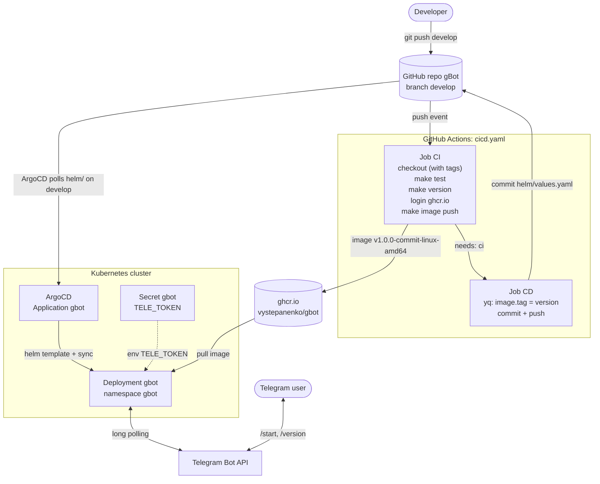

# gBot

A simple Telegram bot written in Go as a test task for the **DevOps and Kubernetes** course.

Bot: [t.me/devops_g_bot](https://t.me/devops_g_bot)

Built with [cobra](https://github.com/spf13/cobra) for the CLI and [telebot v4](https://gopkg.in/telebot.v4) for the Telegram Bot API.

## Requirements

- Go 1.25+
- `make` (optional, for the shortcuts below)
- A Telegram bot token from [@BotFather](https://t.me/BotFather)

## Getting a bot token

1. Open [@BotFather](https://t.me/BotFather) in Telegram.
2. Send `/newbot` and follow the instructions (choose a name and a username ending in `bot`).
3. Copy the token BotFather gives you. It looks like `123456789:AAH...`.

Keep the token secret: anyone who has it can control your bot.

## Configuration

The bot reads its token from the `TELE_TOKEN` environment variable:

```bash
read -s TELE_TOKEN   # paste the token, it won't be echoed
export TELE_TOKEN
```

## Running

### With make

```bash
make run C=start
```

### With go

```bash
go run main.go start
```

### From a built binary

```bash
make build
./gbot start
```

When the bot starts you will see:

```
gBot <version> started
```

The version is taken from git automatically: `<last tag>-<short commit>`, e.g. `v1.0.0-ce7828e`
(`make version` prints it; run `git fetch --tags` first, without tags it is `v0.0.0-<commit>`).

Now open your bot in Telegram and send `/start`.

> Only one instance of the bot can run with the same token at a time. A second one fails with `409 Conflict`.

## CLI commands

| Command         | Description                                   |
|-----------------|-----------------------------------------------|
| `gBot start`    | Start the Telegram bot (alias for `gBot gbot`) |
| `gBot version`  | Print the application version                 |
| `gBot help`     | Show CLI help                                 |

## Bot commands

| Command         | Description                                              |
|-----------------|----------------------------------------------------------|
| `/start`        | Start the bot                                            |
| `/help`         | Show the list of available commands                      |
| `/version`      | Show the bot version                                     |
| `/conversation` | Start a short conversation with inline **Yes/No** buttons |
| `/about`        | Information about the bot                                |

The bot also replies to plain text messages:

| Message          | Reply                                        |
|------------------|----------------------------------------------|
| `hello` / `hi`   | Greets you by your first name                |
| `version`        | Shows the bot version                        |
| anything else    | Suggests typing `/help`                      |

## Make targets

| Target              | Description                                                                                       |
|---------------------|---------------------------------------------------------------------------------------------------|
| `make version`      | Print the version used for binaries and image tags: `<last tag>-<short commit>`                 |
| `make run C=<args>` | Run the app with `go run`. `C` is passed as CLI arguments, e.g. `make run C=start`                |
| `make format`       | Format all Go sources with `gofmt -s -w`                                                          |
| `make lint`         | Run `go vet ./...`                                                                                |
| `make test`         | Run `go test -v ./...`                                                                            |
| `make get`          | Download Go module dependencies                                                                   |
| `make build`        | Build the `gbot` binary for the host platform (or `TARGETOS`/`TARGETARCH` if set)                 |
| `make linux`        | Build for Linux amd64 → `gbot`                                                                    |
| `make arm`          | Build for Linux arm64 → `gbot`                                                                    |
| `make macos`        | Build for macOS arm64 (Apple Silicon) → `gbot`                                                    |
| `make windows`      | Build for Windows amd64 → `gbot.exe`                                                              |
| `make image`        | Build a Docker image for the host architecture                                                    |
| `make push`         | Push the image to the registry (`ghcr.io/vystepanenko/gbot` by default: `REGISTRY`/`REPOSITORY`)  |
| `make clean`        | Remove built binaries and the Docker image (`docker rmi <IMAGE_TAG>`)                             |

## Multi-platform builds and testing (for QA)

This section describes how to build the bot and run tests on different platforms and architectures:
Linux, arm, macOS and Windows.

### Requirements

- `make`, `git`, Go 1.25+ (for local binaries)
- Docker 23+ with BuildKit enabled (the default). A plain `docker build` is used, **no buildx and no QEMU** needed
- **Windows:** run `make` from Git Bash, MSYS2 or WSL (`uname` is needed to detect the host platform); `cmd.exe` and PowerShell are not supported
- Push to the registry only: `docker login ghcr.io`

### Building binaries

Each target cross-compiles a static binary (`CGO_ENABLED=0`) into the project root:

```bash
make linux     # Linux   amd64 → ./gbot
make arm       # Linux   arm64 → ./gbot
make macos     # macOS   arm64 → ./gbot
make windows   # Windows amd64 → ./gbot.exe
```

Any other combination can be built directly:

```bash
make build TARGETOS=darwin TARGETARCH=amd64   # macOS on Intel
make build TARGETOS=linux  TARGETARCH=arm64
```

> All targets except `windows` write to the same `./gbot` file, so the last build overwrites the previous one.

Check the result:

```bash
file gbot        # e.g. "ELF 64-bit LSB executable, ARM aarch64" or "Mach-O 64-bit arm64 executable"
./gbot version   # only on a matching host
```

### Docker image for test runs

`make image` builds an image **for the architecture of the host where it is run**:

| Host                         | Image platform | Emulation      |
|------------------------------|----------------|----------------|
| Linux x86_64                 | `linux/amd64`  | none           |
| Linux arm64 (Raspberry Pi, Graviton) | `linux/arm64` | none   |
| macOS Apple Silicon (M1+)    | `linux/arm64`  | none (no Rosetta, no QEMU) |
| macOS Intel                  | `linux/amd64`  | none           |
| Windows x86_64 (Docker Desktop) | `linux/amd64` | none          |

How this works without emulation: the builder stage runs on the native platform of the build host
(`FROM --platform=$BUILDPLATFORM`), and Go cross-compiles the binary for the target platform
(`GOOS=$TARGETOS GOARCH=$TARGETARCH`). The final image is `scratch` and contains only the binary and CA certificates.

Images are tagged as:

```
<REGISTRY>/<REPOSITORY>:<version>-linux-<arch>
# e.g. ghcr.io/vystepanenko/gbot:v1.0.0-ce7828e-linux-amd64
```

The image is always a Linux image, so the OS part is always `linux` (not the host OS). This matches the
Helm chart, which builds the image reference as `<registry>/<repository>:<tag>-<os>-<arch>`
from `helm/values.yaml`.

The base image (`quay.io/projectquay/golang`) and the registry (`ghcr.io`) are not on Docker Hub,
so Docker Hub licensing and pull rate limits do not apply.

### Typical test flow

```bash
# 1. Build the image for this host
make image

# 2. Find the tag
docker image ls ghcr.io/vystepanenko/gbot

# 3. Run the binary in the container
docker run --rm ghcr.io/vystepanenko/gbot:<tag> version
docker run --rm -e TELE_TOKEN ghcr.io/vystepanenko/gbot:<tag> start

# 4. Clean up: removes the binaries and the image built in step 1
make clean
```

An image for a different architecture can also be built (the binary is still cross-compiled, no emulation during the build).
Running it, however, needs a host with that architecture:

```bash
make image TARGETARCH=arm64
make clean TARGETARCH=arm64
```

> `make clean` removes the image whose tag is computed from the **current** commit.
> Run it before committing or switching branches, otherwise remove the old image manually with `docker rmi <tag>`.

### Release image

A release image is tagged with the release version only (no commit hash), by overriding `VERSION`.
`TARGETARCH=amd64` builds the architecture the Helm chart uses by default, whatever the host architecture:

```bash
make image VERSION=v1.0.0 TARGETARCH=amd64    # → ghcr.io/vystepanenko/gbot:v1.0.0-linux-amd64
make push  VERSION=v1.0.0 TARGETARCH=amd64
make clean VERSION=v1.0.0 TARGETARCH=amd64    # without VERSION, clean targets the <tag>-<commit> image
```

> The published chart `gbot-1.0.0.tgz` (see [Helm](#helm)) predates the `-linux-` part and uses the image
> `ghcr.io/vystepanenko/gbot:v1.0.0-amd64`.

## Helm

The bot can be installed on a Kubernetes cluster with the Helm chart from the [GitHub releases](https://github.com/vystepanenko/gBot/releases).
The chart source is in [`helm/`](helm); on the `develop` branch it is deployed automatically by ArgoCD
(see [CI/CD](#cicd)). The steps below install the published chart `1.0.0`.

1. Create a Telegram bot token with [@BotFather](https://t.me/BotFather) (see [Getting a bot token](#getting-a-bot-token)).
2. Store it in a Kubernetes Secret. The chart reads the key `token` from the Secret `gbot` into `TELE_TOKEN`:

   ```bash
   read -s TELE_TOKEN   # paste the token, it won't be echoed or saved in shell history
   kubectl create secret generic gbot --from-literal=token="$TELE_TOKEN"
   ```

3. Install the chart:

   ```bash
   helm install gbot https://github.com/vystepanenko/gBot/releases/download/v1.0.0/gbot-1.0.0.tgz
   ```

4. Check that the bot is running: the pod is `Running` with 0 restarts and the log shows `gBot v1.0.0 started`
   (the log line alone is not enough: it is printed before the token is checked):

   ```bash
   kubectl get pods -l app.kubernetes.io/instance=gbot
   kubectl logs deploy/gbot
   ```

   Then send `/start` to the bot in Telegram.

Chart values (chart `1.1.0` in [`helm/`](helm); the image is `<registry>/<repository>:<tag>-<os>-<arch>`):

| Value                  | Default              | Description                                                      |
|------------------------|----------------------|------------------------------------------------------------------|
| `image.registry`       | `ghcr.io`            | Container registry                                               |
| `image.repository`     | `vystepanenko/gbot`  | Image repository in the registry                                 |
| `image.tag`            | `v1.0.0-<commit>`    | `<last tag>-<short commit>`; set by CI on every push to `develop` |
| `image.os`             | `linux`              | Image OS, part of the tag                                        |
| `image.arch`           | `amd64`              | Image architecture, the tag suffix                               |
| `teleToken.secretName` | `gbot`               | Secret with the bot token, read into `TELE_TOKEN`                |
| `teleToken.secretKey`  | `token`              | Key of the token in that Secret                                  |
| `replicaCount`         | `1`                  | Keep 1: a second replica with the same token gets `409 Conflict` |

Chart `1.0.0` (the published release) has `image.repository: ghcr.io/vystepanenko`, `image.tag: v1.0.0`,
`image.arch: amd64` and builds the image as `<repository>/<chart name>:<tag>-<arch>`.

The commands above assume the release name `gbot` and the current namespace: with another release name
the Deployment is called `<release>-gbot` (unless the release name already contains `gbot`),
and the Secret must be in the release namespace.

Build and test the chart locally:

```bash
helm lint helm
helm template gbot helm
helm package helm        # → gbot-<chart version>.tgz
```

## CI/CD

Every push to the `develop` branch runs the GitHub Actions workflow [`.github/workflows/cicd.yaml`](.github/workflows/cicd.yaml).
It tests the code, builds the image, pushes it to `ghcr.io` and writes the new tag into `helm/values.yaml`.
ArgoCD watches `helm/` on `develop` and deploys every new tag to Kubernetes (GitOps: CI never talks to the cluster).



| Step | Where | What happens |
|------|-------|--------------|
| 1. Push | developer | `git push` to `develop` triggers the workflow |
| 2. Job `CI` | GitHub Actions | checkout with full history (the version comes from git tags), `make test`, `make version` → `v1.0.0-<commit>`, login to `ghcr.io` with `GITHUB_TOKEN`, `make image push TARGETARCH=amd64` → `ghcr.io/vystepanenko/gbot:v1.0.0-<commit>-linux-amd64` |
| 3. Job `CD` | GitHub Actions | runs only after `CI` succeeded: `yq` sets `image.tag` in `helm/values.yaml` to the same version, `github-actions` commits and pushes it to `develop` (a push with `GITHUB_TOKEN` does not start the workflow again) |
| 4. Sync | ArgoCD | notices the new commit (polls every ~3 minutes), renders the chart and rolls out the Deployment with the new image |
| 5. Run | Kubernetes | the pod pulls the image from `ghcr.io` and the bot answers in Telegram; `/version` shows `v1.0.0-<commit>` |

Runs go one at a time: if several pushes arrive while a run is in progress, only the newest one is built
(the older pending runs are cancelled). After each run `develop` on GitHub has one more commit (the tag update), so
run `git pull` before the next push. If the `CD` push is rejected because `develop` moved meanwhile, don't re-run
it (a re-run checks out the same commit and is rejected again): the run of the newer push sets the tag.

### One-time setup

1. **ghcr.io access for the workflow.** If the package `gbot` was first pushed from the command line, open
   the package settings → *Manage Actions access* → add the repository `gBot` with the **Write** role.
   Otherwise the image push fails with `403`. The package must be public for the cluster to pull it without credentials.
2. **Kubernetes cluster with ArgoCD**, e.g. a local [kind](https://kind.sigs.k8s.io/) cluster with its own kubeconfig:

   ```bash
   kind create cluster --name gbot-argocd --kubeconfig ~/.kube/gbot-argocd.yaml
   export KUBECONFIG=~/.kube/gbot-argocd.yaml
   kubectl config current-context    # kind-gbot-argocd
   kubectl create namespace argocd
   kubectl apply -n argocd --server-side -f https://raw.githubusercontent.com/argoproj/argo-cd/stable/manifests/install.yaml
   kubectl wait -n argocd --for=condition=Ready pods --all --timeout=300s
   ```

   > Every `kubectl` command in this section and in [Check a deployment](#check-a-deployment) must target
   > this cluster. `KUBECONFIG` is set only in the current shell: in a new terminal run the `export` again
   > (each block below starts with it), otherwise `kubectl` falls back to the default kubeconfig and its
   > current context, which may be a different cluster.

3. **Bot token Secret** in the namespace the bot runs in (the token is never stored in git):

   ```bash
   export KUBECONFIG=~/.kube/gbot-argocd.yaml
   kubectl create namespace gbot
   read -s TELE_TOKEN
   kubectl create secret generic gbot -n gbot --from-literal=token="$TELE_TOKEN"
   ```

4. **ArgoCD Application** ([`argocd/application.yaml`](argocd/application.yaml)): chart `helm/` from the branch
   `develop`, release `gbot` in the namespace `gbot`, automatic sync:

   ```bash
   export KUBECONFIG=~/.kube/gbot-argocd.yaml
   kubectl apply -f argocd/application.yaml
   ```

### Check a deployment

```bash
export KUBECONFIG=~/.kube/gbot-argocd.yaml
kubectl get application gbot -n argocd     # SYNC STATUS Synced, HEALTH STATUS Healthy
kubectl get pods -n gbot                   # Running, 0 restarts
kubectl logs -n gbot deploy/gbot           # gBot v1.0.0-<commit> started
```

Then send `/version` to the bot: it answers with the same `v1.0.0-<commit>` as `image.tag` in `helm/values.yaml`.

ArgoCD UI: `kubectl port-forward svc/argocd-server -n argocd 8080:443`, open https://localhost:8080,
user `admin`, password from `kubectl get secret argocd-initial-admin-secret -n argocd -o jsonpath='{.data.password}' | base64 -d`.

## Project structure

```
.
├── main.go               # entry point, calls cmd.Execute()
├── Makefile              # build, cross-compile, image and clean targets
├── Dockerfile            # multi-stage build: quay.io golang builder → scratch
├── .dockerignore         # files excluded from the Docker build context
├── .github/workflows/
│   └── cicd.yaml         # CI/CD: test, build and push the image, update the tag in the chart
├── argocd/
│   └── application.yaml  # ArgoCD Application: deploys helm/ from the develop branch
├── helm/                 # Helm chart `gbot`
│   ├── Chart.yaml        # chart version and appVersion
│   ├── values.yaml       # image (tag updated by CI) and TELE_TOKEN Secret settings
│   └── templates/        # Deployment, helpers, install notes
├── cmd/                  # CLI commands (cobra)
│   ├── root.go           # root command
│   ├── gbot.go           # `gbot` (`start`) command: creates and starts the bot
│   └── version.go        # `version` command and appVersion variable
└── internal/bot/         # Telegram bot logic
    ├── bot.go            # command list and handler registration (Register)
    ├── start.go          # /start
    ├── help.go           # /help (generated from the command list)
    ├── text.go           # plain text messages (OnText)
    ├── version.go        # /version
    ├── about.go          # /about
    └── conversation.go   # /conversation and inline buttons
```

## Adding a new bot command

1. Declare it in `internal/bot/bot.go`:
   ```go
   cmdPing = command{name: "/ping", description: "check that the bot is alive"}
   ```
2. Add it to the `commands` slice so it appears in `/help`.
3. Create a handler in its own file, e.g. `internal/bot/ping.go`:
   ```go
   func handlePing(ctx telebot.Context) error {
   	return ctx.Send("pong")
   }
   ```
4. Register it in `Register`:
   ```go
   gbot.Handle(cmdPing.name, handlePing)
   ```
